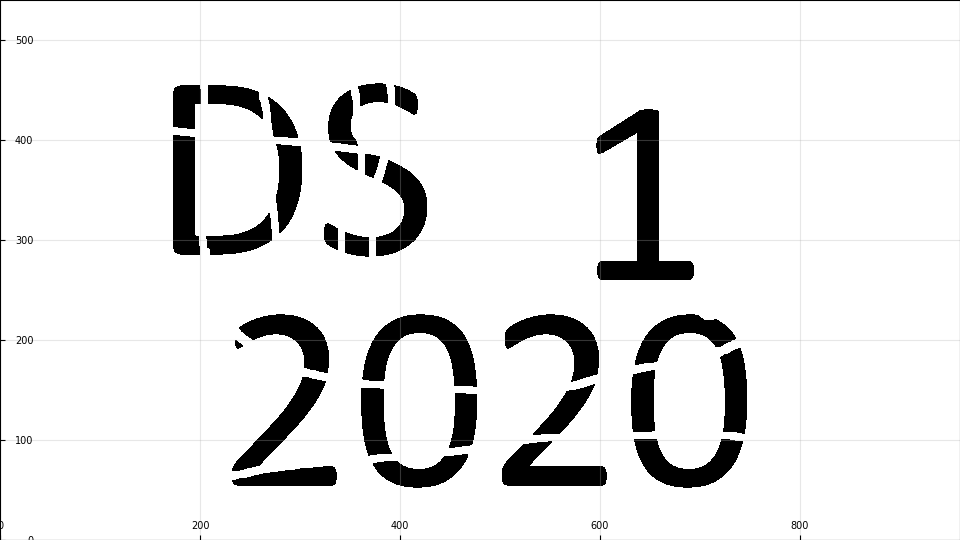

# Лабораторна робота 2

**Виконала:** Проніна Катерина Сергіївна

**Група:** КМ-51

**Датасет:** DS1 

## Мета роботи

Зчитати датасет (набір точок на площині) з текстового файлу та відобразити його у вікні (полотні) розміром 960×540 пкс, розмістивши початок координат (0; 0) у нижньому лівому куті, з додатним напрямком осі Y угору та осі X управо. Зберегти результат у графічному форматі.

## Хід роботи

1. Обрано індивідуальний датасет **DS1** (остання цифра логіну — 1) і завантажено файл `DS1.txt`. Файл у текстовому форматі містить пари цілих чисел `x y` — координати точок.
2. Файл прочитано в масив `numpy` розмірністю `N × 2`. Визначено кількість точок і діапазони координат та перевірено, що всі точки вміщуються у полотно 960×540.
3. Створено полотно розміром 960×540 пкс: фігура `figsize = (9.6; 5.4)` дюйма при `dpi = 100`. Область побудови розтягнуто на всю фігуру (`add_axes([0, 0, 1, 1])`), а межі осей встановлено `0…960` по X та `0…540` по Y. Завдяки цьому **1 одиниця координат дорівнює 1 пікселю**. Початок координат (0; 0) розташований у нижньому лівому куті, вісь Y спрямована вгору, вісь X — управо.
4. Точки датасету відображено на полотні (чорні квадратні маркери), додано допоміжну сітку та підписи осей усередині полотна для орієнтації.
5. Результат збережено у файл `DS1_plot.png`; розмір зображення перевірено — 960×540 пкс.

## Використані бібліотеки та методи

| Бібліотека | Методи / функції | Призначення |
|---|---|---|
| `numpy` | `loadtxt`, зрізи `[:, 0]`, `min`, `max`, булеві маски | зчитування датасету, аналіз діапазонів координат |
| `matplotlib.pyplot` | `figure`, `add_axes`, `set_xlim`, `set_ylim`, `scatter`, `grid`, `tick_params`, `savefig`, `show` | створення полотна 960×540, відображення точок, збереження у PNG |
| `Pillow` | `Image.open` | перевірка розміру збереженого зображення |
| `pathlib` | `Path` | робота зі шляхами до файлів |

## Результат

| Параметр | Значення |
|---|---|
| Кількість точок | 45 915 |
| Діапазон X | 174 … 746 |
| Діапазон Y | 53 … 456 |
| Розмір полотна | 960 × 540 пкс |

## Висновок

У ході роботи датасет DS1 зчитано з текстового файлу та відображено на полотні 960×540 пкс із початком координат у нижньому лівому куті. Точки утворюють напис «DS 1 2020». Результат збережено у файлі `DS1_plot.png`.

## Файли

- [`lab2.ipynb`](lab2.ipynb) — програма (Jupyter Notebook);
- [`DS1.txt`](DS1.txt) — вихідний датасет;
- [`DS1_plot.png`](DS1_plot.png) — результат.
