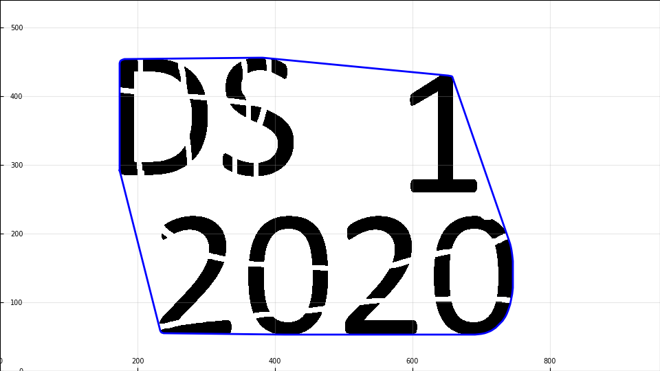

# Лабораторна робота 3

**Виконала:** Проніна Катерина Сергіївна

**Група:** КМ-51

**Датасет:** DS1 

## Мета роботи

Вивчити алгоритми побудови опуклої оболонки, їх характеристики, властивості та сфери застосування. Знайти опуклу оболонку датасету з лабораторної роботи №2, зберегти її як окремий датасет та відобразити разом із вихідними точками.

## Теоретичні відомості

**Опукла оболонка** скінченної множини точок на площині — найменший опуклий многокутник, що містить усі точки множини (гумова стрічка, натягнута навколо «цвяхів»). Усі вершини оболонки є точками вихідної множини; оболонка має мінімальні площу та периметр серед усіх опуклих фігур, що містять множину.

| Алгоритм | Ідея | Складність (n — число точок, h — число вершин оболонки) |
|---|---|---|
| Джарвіса (gift wrapping) | від поточної вершини обирається точка, відносно якої всі інші лежать з одного боку | O(n·h) |
| Грехема / Ендрю (monotone chain) | сортування точок і стек, що відкидає невипуклі повороти; нижній та верхній ланцюги будуються окремо | O(n log n) |
| QuickHull | «розділяй і володарюй» | у середньому O(n log n), у гіршому O(n²) |
| Чана | поєднання Грехема та Джарвіса | O(n log h) |

**Сфери застосування:** комп'ютерна графіка й розпізнавання образів, геоінформаційні системи, виявлення зіткнень у іграх і робототехніці, статистика (виявлення викидів), оцінка діаметра множини, планування шляху.

## Хід роботи

1. Вивчено алгоритми побудови опуклої оболонки, їх складність, властивості та застосування (див. вище).
2. Датасет **DS1** з лабораторної роботи №2 зчитано з текстового файлу в масив `numpy`.
3. Реалізовано два алгоритми:
   - **Ендрю (monotone chain)**, O(n log n): точки сортуються за (x, y); за допомогою стека окремо будуються нижній і верхній ланцюги, а точки, що утворюють поворот не ліворуч, відкидаються (визначається за знаком векторного добутку `cross`); ланцюги з'єднуються;
   - **Джарвіса**, O(n·h): починаючи з найлівішої точки, на кожному кроці обирається точка, правіше якої немає інших; колінеарні точки відкидаються, лишається найвіддаленіша.

   Координати цілі, тому векторні добутки обчислюються точно, без похибок округлення.
4. Результат перевірено: обидва алгоритми дали однакову оболонку, яка збігається з результатом `scipy.spatial.ConvexHull` (збіглися множина вершин, площа та периметр).
5. Оболонку збережено окремим датасетом у файл `hull_DS1.txt` (вершини в порядку проти годинникової стрілки, формат `x y`, як і у вихідного датасету).
6. На полотні 960×540 пкс відображено точки вихідного датасету (чорні) та опуклу оболонку відрізками синього кольору. Результат збережено у файл `hull_result.png`.

## Використані бібліотеки та методи

| Бібліотека | Методи / функції | Призначення |
|---|---|---|
| `numpy` | `loadtxt`, `savetxt`, `unique`, `vstack`, `roll`, `dot`, `hypot` | зчитування/збереження датасетів, обчислення площі та периметра |
| `matplotlib.pyplot` | `figure`, `add_axes`, `set_xlim`, `set_ylim`, `scatter`, `plot`, `savefig`, `show` | відображення точок та оболонки на полотні 960×540 |
| `scipy.spatial` | `ConvexHull` | незалежна перевірка власної реалізації |
| стандартна бібліотека Python | `time.perf_counter`, `pathlib.Path`, `sorted`, `set` | вимірювання часу, шляхи до файлів, підготовка точок |
| `Pillow` | `Image.open` | перевірка розміру збереженого зображення |

## Результат

| Параметр | Значення |
|---|---|
| Кількість точок датасету | 45 915 |
| Кількість вершин опуклої оболонки | 36 |
| Площа оболонки | 204 733,5 |
| Периметр оболонки | 1 763,58 |
| Час роботи: Ендрю / Джарвіс | близько 70 мс / близько 380 мс |
| Збіг із `scipy.spatial.ConvexHull` | так |

## Висновок

У роботі побудовано опуклу оболонку датасету DS1 (45 915 точок): вона має 36 вершин. Два незалежні алгоритми (Ендрю та Джарвіса) і бібліотечна реалізація `scipy` дали однаковий результат. Оскільки h ≪ n, алгоритм Джарвіса O(n·h) також працює прийнятно, проте monotone chain O(n log n) помітно швидший і не залежить від форми оболонки. Оболонку збережено окремим датасетом `hull_DS1.txt`, а візуалізацію — у `hull_result.png` (960×540 пкс).

## Файли

- [`lab3.ipynb`](lab3.ipynb) — програма (Jupyter Notebook);
- [`DS1.txt`](DS1.txt) — вихідний датасет;
- [`hull_DS1.txt`](hull_DS1.txt) — опукла оболонка (окремий датасет);
- [`hull_result.png`](hull_result.png) — результат.
