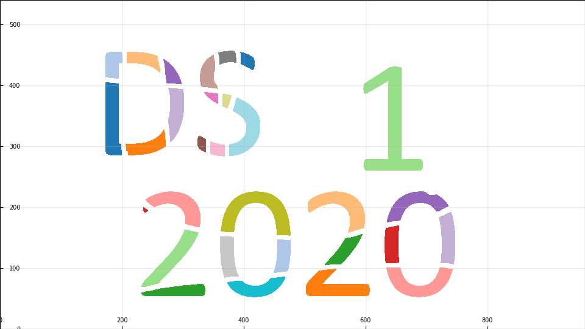
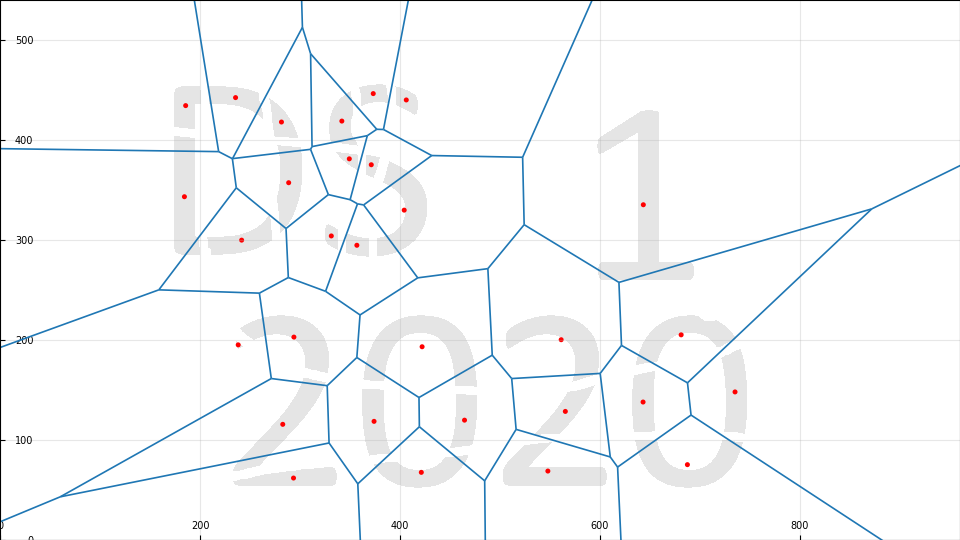

# Лабораторна робота 4

**Виконала:** Проніна Катерина Сергіївна

**Група:** КМ-51

**Датасет:** DS1 

## Мета роботи

Дослідити алгоритми знаходження зв'язаних областей та алгоритми побудови діаграм Вороного. Розділити датасет на зв'язані області, знайти їх центри ваги та побудувати діаграму Вороного за множиною цих центрів.

## Теоретичні відомості

**Зв'язана область.** Усі точки датасету мають один колір (решта полотна — фон), тому зв'язана область — це множина точок, будь-які дві з яких можна з'єднати ланцюжком сусідніх точок цієї ж множини, і між якими немає точок іншого кольору. Сусідство задають двома способами: *4-зв'язність* (спільна сторона) та *8-зв'язність* (додатково діагональні сусіди; використана в цій роботі). Основні алгоритми: обхід у ширину/глибину (flood fill) — O(n), union-find, двопрохідне маркування Розенфельда–Пфальца. Застосування: обробка зображень, розпізнавання образів (OCR), аналіз геоданих, медична візуалізація.

**Центр ваги** області — середнє арифметичне координат усіх її точок: $x_c = \frac{1}{k}\sum x_i$, $y_c = \frac{1}{k}\sum y_i$.

**Діаграма Вороного** для множини точок-«сайтів» — розбиття площини на комірки, кожна з яких складається з точок, що ближчі до свого сайту, ніж до будь-якого іншого. Комірки є опуклими многокутниками, а діаграма дуальна до тріангуляції Делоне. Алгоритми: Форчуна (заметаюча пряма) — O(n log n), через тріангуляцію Делоне, «розділяй і володарюй», інкрементальний. Застосування: задачі найближчого сусіда та геолокації (найближча станція/лікарня), аналіз територій, комп'ютерна графіка, моделювання росту кристалів, планування руху роботів.

## Хід роботи

1. Досліджено алгоритми пошуку зв'язаних областей та побудови діаграм Вороного (див. вище).
2. Датасет **DS1** з лабораторної роботи №2 зчитано з текстового файлу в масив `numpy`.
3. Датасет поділено на зв'язані області алгоритмом **обходу в ширину (BFS)** з 8-сусідством: беремо довільну необроблену точку, додаємо її до нової області та по черзі розглядаємо сусідів; знайдені сусіди переходять зі множини необроблених до області, поки черга не спорожніє. Множина `set` дозволяє перевіряти належність за O(1), тому весь алгоритм має складність O(n). Для порівняння виконано пошук і з 4-сусідством; результат 8-зв'язності перевірено за допомогою `scipy.ndimage.label`.
4. Для кожної області знайдено **центр ваги** як середнє арифметичне координат (`mean(axis=0)`). Центри збережено у файл `centers_DS1.txt`.
5. За множиною центрів ваги побудовано **діаграму Вороного** (`scipy.spatial.Voronoi`). Нескінченні ребра подовжено в потрібному напрямку та обрізано межами полотна.
6. На полотні 960×540 пкс відображено: діаграму Вороного (сині лінії), точки вихідного датасету (чорні, насиченість 10 %, `alpha = 0.1`) і центри ваги (червоні кола діаметром 5 пкс). Результат збережено у `voronoi_result.png`.

## Використані бібліотеки та методи

| Бібліотека | Методи / функції | Призначення |
|---|---|---|
| `numpy` | `loadtxt`, `savetxt`, `array`, `mean(axis=0)`, булеві маски | зчитування/збереження датасетів, обчислення центрів ваги |
| `collections` | `deque` | черга для обходу в ширину |
| `scipy.spatial` | `Voronoi` (`vertices`, `ridge_points`, `ridge_vertices`) | побудова діаграми Вороного |
| `scipy.ndimage` | `label` | незалежна перевірка пошуку зв'язаних областей |
| `matplotlib` | `figure`, `add_axes`, `scatter`, `LineCollection`, `Circle`, `add_patch`, `savefig`, `show` | відображення на полотні 960×540 та збереження у PNG |
| `Pillow` | `Image.open` | перевірка розміру збереженого зображення |

## Результат

| Параметр | Значення |
|---|---|
| Кількість точок датасету | 45 915 |
| Зв'язаних областей (8-зв'язність) | 30 |
| Зв'язаних областей (4-зв'язність, для порівняння) | 34 |
| Збіг із `scipy.ndimage.label` | так |
| Вершин діаграми Вороного | 47 |
| Ребер діаграми Вороного (з них нескінченних) | 76 (11) |

**Знайдені зв'язані області** (відображено різними кольорами):

**Центри ваги областей:**

| № | Кількість точок | xc | yc |
|---:|---:|---:|---:|
| 1 | 2544 | 184.42 | 343.28 |
| 2 | 972 | 185.66 | 434.39 |
| 3 | 1235 | 241.64 | 299.86 |
| 4 | 993 | 235.57 | 442.40 |
| 5 | 1381 | 293.52 | 61.96 |
| 6 | 2207 | 282.76 | 115.67 |
| 7 | 28 | 238.21 | 195.14 |
| 8 | 2187 | 293.91 | 202.90 |
| 9 | 610 | 281.46 | 417.98 |
| 10 | 1615 | 288.67 | 357.29 |
| 11 | 256 | 331.31 | 304.06 |
| 12 | 999 | 341.84 | 418.92 |
| 13 | 211 | 349.31 | 381.16 |
| 14 | 437 | 356.86 | 294.72 |
| 15 | 482 | 373.24 | 446.40 |
| 16 | 1427 | 374.05 | 118.65 |
| 17 | 3358 | 422.10 | 193.25 |
| 18 | 235 | 371.28 | 375.26 |
| 19 | 1617 | 421.31 | 67.65 |
| 20 | 2358 | 404.20 | 329.86 |
| 21 | 426 | 406.28 | 440.05 |
| 22 | 1101 | 464.52 | 119.84 |
| 23 | 2530 | 547.87 | 68.94 |
| 24 | 2554 | 561.17 | 200.29 |
| 25 | 1114 | 565.34 | 128.58 |
| 26 | 5607 | 643.33 | 335.25 |
| 27 | 1269 | 643.06 | 137.97 |
| 28 | 2464 | 687.41 | 75.35 |
| 29 | 2003 | 681.15 | 205.16 |
| 30 | 1695 | 735.04 | 148.07 |

**Діаграма Вороного за центрами ваги:**

## Висновок

Датасет DS1 (45 915 точок) поділено на 30 зв'язаних областей (при 4-зв'язності їх було б 34). Для кожної області знайдено центр ваги, а за ними побудовано діаграму Вороного, що розбиває полотно на 30 комірок. Правильність пошуку областей підтверджено незалежною перевіркою `scipy.ndimage.label`. Результат відображено на полотні 960×540 пкс і збережено у `voronoi_result.png`, центри ваги — у `centers_DS1.txt`.

## Файли

- [`lab4.ipynb`](lab4.ipynb) — програма (Jupyter Notebook);
- [`DS1.txt`](DS1.txt) — вихідний датасет;
- [`centers_DS1.txt`](centers_DS1.txt) — центри ваги зв'язаних областей;
- [`regions_DS1.png`](regions_DS1.png) — знайдені області;
- [`voronoi_result.png`](voronoi_result.png) — результат.
